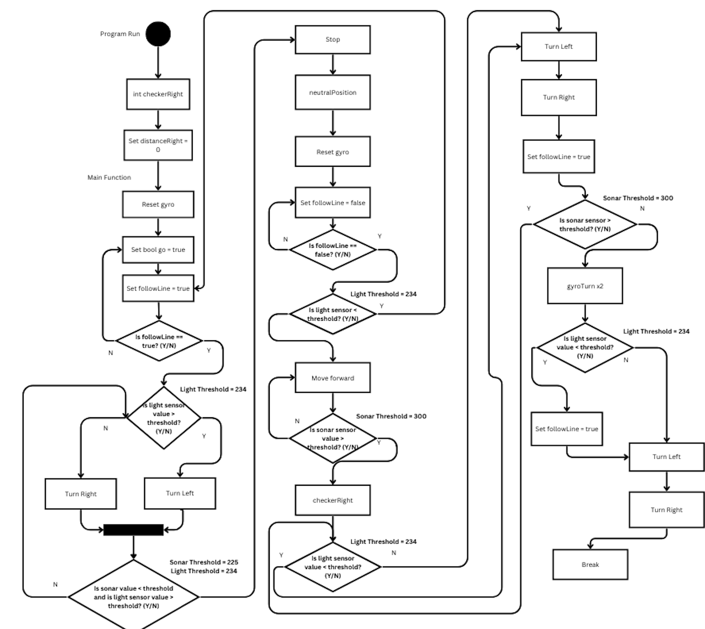
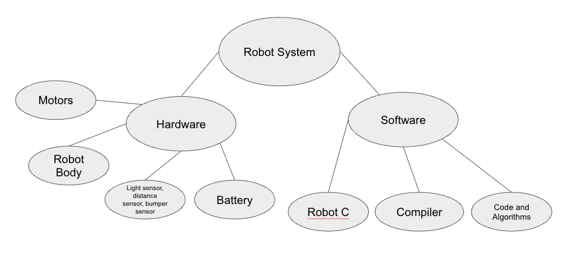
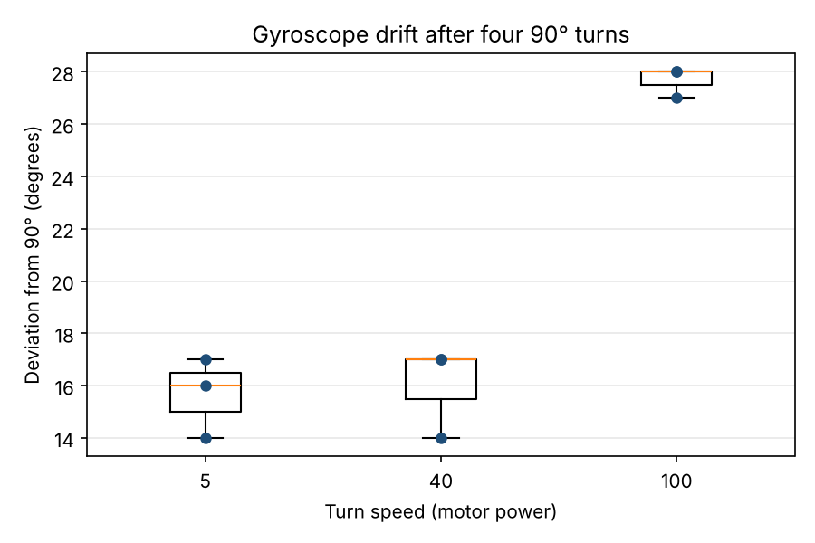

# VEX Robot: Applying the Systems Engineering Process

A team project for EMSE 2801: Fundamentals of Systems Engineering (Fall 2024). We programmed and adapted a VEX robot to complete five weekly challenges, using systems engineering methods at each step: concept of operations, requirements, system architecture, logic flow design, and verification and validation testing.



## Challenges

| Demo | Challenge | Goal |
|---|---|---|
| A | Vacuum | Bump into all four walls of a rectangular space and return to the start |
| B | Line Follower | Follow a black tape line from start to finish using light sensors |
| C | Pipeline Explorer | Travel a tunnel twice and record the distance of each black line from the start |
| D | Wall Follower | Navigate a maze by following its walls |
| E | Line/Wall Follower | Navigate a maze by switching between line following and wall following |

## Systems engineering approach

- **Concept of operations:** for each challenge, we defined success criteria and the functions the robot needed before writing any code.
- **System architecture:** we broke the robot into hardware (motors, body, sensors, battery) and software (RobotC, compiler, algorithms) subsystems and mapped the interfaces between them.
- **Requirements:** we wrote functional, performance, physical, interface and reliability requirements, including derived, decomposed and allocated requirements.
- **Logic flow design:** we drew a logic flow diagram before coding each challenge, which made the code easier to write and debug.
- **Key design decision:** switching from a left-line follower to a right-line follower fixed the robot losing the line on sharp turns.



## Verification test: gyroscope drift

We tested how turn speed affects the accuracy of 90° turns. The robot made four turns at each of three speeds, three trials each, and we measured how far it ended from 90°.

| Turn speed | Mean deviation from 90° |
|---|---|
| 5 | 15.7° |
| 40 | 16.0° |
| 100 | 27.7° |

Small changes in speed made little difference, but a large jump in speed nearly doubled the drift, so we used slower turn speeds for accurate turns.



To recreate the chart:

```bash
pip install -r requirements.txt
python analyze_gyro_drift.py
```

## Repository structure

```
├── report/VEX_Robot_Final_Report.pdf   # Full final report
├── data/gyroscope_drift.csv            # Test data (Appendix A of the report)
├── analyze_gyro_drift.py               # Summary statistics and boxplot
└── figures/                            # Architecture, logic flows and test chart
```

## Team

Alana Lee, Shannon Zhang, Sergio Ley, Jeremy Lu Diaz and Sami Gebeyehu, The George Washington University.

**Tools:** RobotC, VEX robotics kit, Python (pandas, matplotlib) for the test analysis.
